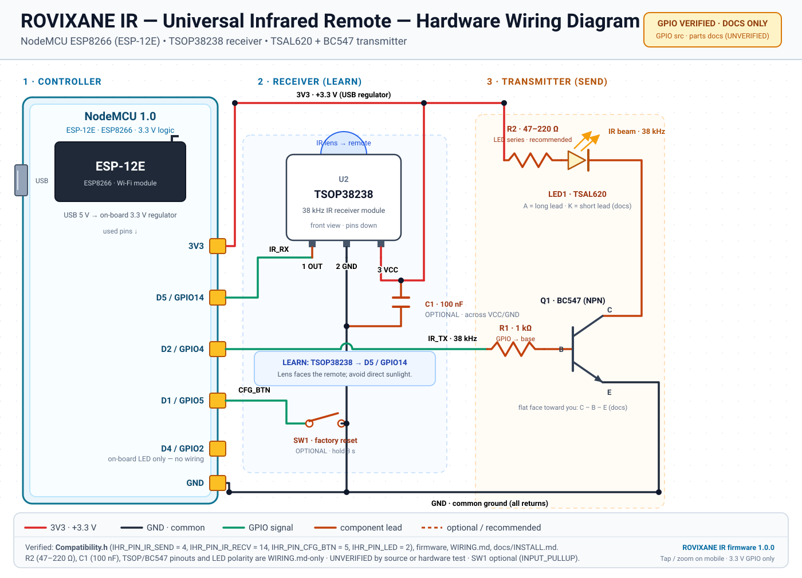

# ROVIXANE IR — Universal Infrared Remote

[](https://github.com/ROVIXANE/ROVIXANE-IR/actions/workflows/ci.yml)
[](https://github.com/ROVIXANE/ROVIXANE-IR/releases/latest)

**ROVIXANE IR** হলো NodeMCU ESP8266 ESP-12E-এর উপর ভিত্তি করে তৈরি একটি ওপেন-সোর্স, অফলাইন-ফার্স্ট Wi-Fi ইনফ্রারেড রিমোট। ফোনের ব্রাউজার থেকে টিভি, এসি, ফ্যান, সেট-টপ বক্স বা নিজের বানানো রিমোটের বাটন চাপুন, আসল রিমোট থেকে প্রতি বাটন আলাদা করে শিখুন, পছন্দের বাটন সেভ করুন—ইন্টারনেটের প্রয়োজন নেই।

**English:** ROVIXANE IR is an open-source, offline-first universal infrared remote controller built on the NodeMCU ESP8266 ESP-12E. It serves a mobile-first dashboard directly from the microcontroller, learns signals from an existing remote, stores reusable profiles, and keeps every asset locally in the firmware.

> **সংস্করণ:** এই শাখাটি **v2.0.0**। আগের প্রকাশিত **v1.0.0** release ও তার asset অপরিবর্তিত রাখা হয়েছে। v2.0.0 release GitHub Actions-এ host test ও বাস্তব ESP8266 compile সফল হলেই প্রকাশিত হয়।

---

## দ্রুত লিংক

| যা খুঁজছেন | লিংক |
|---|---|
| ফার্মওয়্যার ডাউনলোড | [GitHub Releases](https://github.com/ROVIXANE/ROVIXANE-IR/releases/latest) |
| নতুন ব্যবহারকারীর ইনস্টলেশন | [docs/INSTALL.md](docs/INSTALL.md) |
| ড্যাশবোর্ড ব্যবহার | [docs/DASHBOARD.md](docs/DASHBOARD.md) |
| সাধারণ প্রশ্ন ও সমস্যা | [docs/FAQ.md](docs/FAQ.md) |
| ওয়্যারিং ও GPIO | [WIRING.md](WIRING.md) |
| নিরাপত্তা তথ্য | [SECURITY.md](SECURITY.md) |
| অবদান | [CONTRIBUTING.md](CONTRIBUTING.md) |
| সংস্করণ ইতিহাস | [CHANGELOG.md](CHANGELOG.md) |

---

## পরিচিতি

| বিবরণ | তথ্য |
|---|---|
| ব্র্যান্ড | ROVIXANE |
| প্রকল্প | ROVIXANE-IR |
| রিপোজিটরি | [github.com/ROVIXANE/ROVIXANE-IR](https://github.com/ROVIXANE/ROVIXANE-IR) |
| হার্ডওয়্যার | NodeMCU ESP8266 ESP-12E |
| বর্তমান সংস্করণ | v2.0.0 |
| ইন্টারফেস | বাংলা ও ইংরেজি; ড্যাশবোর্ডে এক ক্লিকে বদলানো যায়; ডার্ক/লাইট |
| সংযোগ | 2.4 GHz Wi-Fi, AP মোডে `ROVIXANE-IR-Setup`, IP `192.168.4.1` |
| অফলাইন | HTML, CSS, JS, PWA manifest—সব ফার্মওয়্যারের ভেতরে |
| আপডেট | ফোনের ব্রাউজার থেকে `.bin` OTA upload (auth + CSRF সুরক্ষিত) |



> GPIO সংজ্ঞা firmware/`Compatibility.h`-এ যাচাই করা। কম্পোনেন্ট pinout, LED polarity ও R/C মান শুধু ডকুমেন্টেশনে আছে এবং **UNVERIFIED** হিসেবে চিহ্নিত। মোবাইলে ছবিতে ট্যাপ করে জুম করুন; [SVG](docs/images/rovixane-ir-wiring.svg) ও [PNG](docs/images/rovixane-ir-wiring.png) দুই ফরম্যাটেই আছে। বিস্তারিত: [WIRING.md](WIRING.md)।

---

## V2-তে নতুন কী

| বৈশিষ্ট্য | কীভাবে কাজ করে |
|---|---|
| প্রথম বুটে সেটআপ | ফ্রেশ ডিভাইসে login বাধ্যতামূলক; `/api/setup` দিয়ে অ্যাডমিন পাসওয়ার্ড না দেওয়া পর্যন্ত লেখা/পাঠানো/OTA বন্ধ |
| নিরাপদ API | সব পরিবর্তনকারী request-এ `X-ROVIXANE-CSRF: 1` ও `Content-Type: application/json`; গোপন তথ্য response-এ mask করা |
| Universal remote UI | TV, AC, Fan, STB টেমপ্লেট + প্রতি বাটনের learn/edit/delete |
| Custom remote builder | নাম, আইকন, রঙ, গ্রিড প্রস্থ ও বাটন লেআউট নিজে তৈরি |
| Favorites ও recents | তারকা চিহ্নিত বাটন হোমে; সাম্প্রতিক ব্যবহার করা বাটন আলাদা তালিকায় |
| Per-button learning | শেখা সংকেত সরাসরি নির্দিষ্ট বাটনে বসানো; সমর্থিত প্রোটোকল বা Raw |
| AC state | তাপমাত্রা/মোড/ফ্যান state UI-তে রাখা হয় এবং ম্যাপ করা শেখা সংকেত পাঠানো হয় (নকল প্রোটোকল এনকোডিং নয়) |
| Mobile OTA | streaming upload, `0xE9` magic ও সাইজ যাচাই; ব্যর্থ হলে পুরোনো firmware চালু থাকে |
| Crash-safe storage | atomic write, `.bak` recovery, corrupt/oversized database মুছে ফেলা হয় না |
| Diagnostics | firmware, schema, uptime, heap, filesystem, Wi-Fi, reset reason |

---

## প্রয়োজনীয় জিনিস

### হার্ডওয়্যার

- NodeMCU ESP8266 ESP-12E
- TSOP38238 ইনফ্রারেড রিসিভার
- TSAL620 ইনফ্রারেড LED
- BC547 ট্রানজিস্টর
- 1 kΩ রেজিস্টার (BC547 বেসের জন্য)
- IR LED-র সাথে 47–220 Ω রেজিস্টার যোগ করার পরামর্শ; মান নির্ভরশীল ও **UNVERIFIED**
- ঐচ্ছিক: 100 nF ক্যাপাসিটর, ফ্যাক্টরি রিসেটের push button

### সফটওয়্যার

- প্রস্তুত BIN ব্যবহার করলে Arduino IDE লাগবে না
- নিজে কম্পাইল করতে চাইলে Arduino IDE 2.x
- ESP8266 board package 3.1.2
- ArduinoJson 7.4.2 এবং IRremoteESP8266 2.8.6
- Termux/Android-এ ফ্ল্যাশ করলে `python3` ও `esptool`

---

## দ্রুত শুরু: প্রকাশিত BIN

1. [সর্বশেষ Release](https://github.com/ROVIXANE/ROVIXANE-IR/releases/latest) খুলুন।
2. NodeMCU BIN এবং মিলে যাওয়া `.sha256.txt` ডাউনলোড করুন।
3. checksum যাচাই করুন:

```sh
cd ~/Downloads
sha256sum -c rovixane-ir-nodemcuv2-v2.0.0.sha256.txt
```

4. USB OTG দিয়ে বোর্ড সংযোগ করুন ও ফ্ল্যাশ করুন:

```sh
pkg install python
pip install esptool
ls /dev/ttyUSB* /dev/ttyACM* 2>/dev/null
python3 -m esptool --chip esp8266 --port /dev/ttyUSB0 --baud 115200 \
  write_flash --flash_size 4MB1M 0x00000 \
  rovixane-ir-nodemcuv2-v2.0.0.bin
```

> **পুরোনো v1.0.0 asset:** প্রকাশিত v1.0.0 ফাইলের নাম `ihr-universal-ir-remote-nodemcuv2-v1.0.0.bin`—ইতিহাস অপরিবর্তিত। v2.0.0 থেকে নাম `rovixane-ir-nodemcuv2-vX.X.X.bin`, SSID `ROVIXANE-IR-Setup`।

PORT `/dev/ttyACM0` হতে পারে। “Connecting……”-এ আটকে গেলে বোর্ডের **FLASH** বাটন চেপে রেখে কমান্ড চালান। LittleFS upload লাগবে না—ওয়েব পেজগুলো BIN-এর ভেতরেই আছে। v1.0.0 থেকে আপডেট করলে `/config.json` ও `/signals.json` সাধারণত সংরক্ষিত থাকে, তবুও আগে backup নিন। বিস্তারিত: [INSTALL.md](docs/INSTALL.md)।

---

## প্রথম বুট: সেটআপ মোড

1. বোর্ডে পাওয়ার দিন; প্রায় ৫–১২ সেকেন্ড অপেক্ষা করুন।
2. ফোনে `ROVIXANE-IR-Setup` Wi-Fi নেটওয়ার্কে সংযোগ করুন। প্রথম সেটআপে AP খোলা থাকে।
3. Android “No internet” বললে **Stay connected** / **Use this network as-is** বেছে নিন।
4. ব্রাউজারে `http://192.168.4.1` খুলুন।
5. **Create admin password** স্ক্রিনে একটি শক্তিশালী পাসওয়ার্ড (কমপক্ষে ৮ অক্ষর) দিন।
6. **Settings** → `Wi-Fi network (SSID)` ও `Wi-Fi password` দিন → **Save settings** → **Restart**।
7. ফোনকে আপনার নিজের 2.4 GHz Wi-Fi তে সংযোগ করে router-এর client list বা Serial Monitor থেকে IP বের করুন।

> সেটআপ শেষ না হলে শুধু ড্যাশবোর্ড, manifest, CSS/JS ও read-only status পড়া যায়; config/signals লেখা, IR পাঠানো ও OTA 403/401 দিয়ে বন্ধ থাকে।

Wi-Fi ব্যর্থ হলে প্রায় ১২ সেকেন্ড পর setup AP ফিরে আসে, তাই ডিভাইস “হারিয়ে” যায় না। নিরাপত্তার জন্য Settings-এ AP password দিতে পারেন; খালি রাখলে AP খোলা থাকে।

---

## Arduino IDE থেকে source বিল্ড

1. Arduino IDE 2.x-এ **File → Preferences → Additional boards manager URLs**-এ দিন:
   `http://arduino.esp8266.com/stable/package_esp8266com_index.json`
2. **Boards Manager** → `esp8266 by ESP8266 Community 3.1.2` ইনস্টল করুন।
3. **Library Manager** → `ArduinoJson 7.4.2`, `IRremoteESP8266 2.8.6` ইনস্টল করুন।
4. রিপোজিটরি ফোল্ডার খুলুন; `rovixane-ir.ino` অটো খুলবে। **folder-এর নাম হতে হবে `rovixane-ir`** (Arduino IDE-র নিয়ম)।
5. Board: **NodeMCU 1.0 (ESP-12E Module)**, Flash Size: **4MB (FS:1MB OTA:~1019KB)**, CPU: **80 MHz**, Upload Speed: **115200**।
6. Upload করুন; Serial Monitor 115200-এ `ROVIXANE IR 2.0.0 ready` দেখলে firmware চলছে।

`data/`-এ কোনো web ফাইল বদলালে আগে চালান:

```sh
python3 tools/generate_assets.py
```

---

## ড্যাশবোর্ড পরিচিতি

- **Home:** favorites, সাম্প্রতিক বাটন, quick actions ও সব রিমোটের কার্ড।
- **Search:** রিমোট বা বাটনের নাম দিয়ে খোঁজা।
- **TV / STB:** power, navigation, volume, channel, number pad ও media keys; শেখা সংকেত বাটনে ম্যাপ করুন।
- **AC:** power, temperature +/−, mode, fan, swing, turbo, eco, sleep ও timer; UI state রাখে, সংকেত আসে আপনার শেখা/ম্যাপ করা কোড থেকে।
- **Fan:** power, speed, mode, oscillation, timer ও light।
- **Custom:** নিজের নাম, আইকন, রঙ, গ্রিড প্রস্থ ও বাটন সংখ্যা।
- **Learn sheet:** যেকোনো বাটনে ✎/Learn চাপুন → আসল রিমোটের বাটন ধরে রাখুন → প্রোটোকল/HEX/বিট বা Raw timings দেখে **Save to button**।
- **Profiles:** প্রোফাইল তৈরি, সম্পাদনা, ডুপ্লিকেট, ডিফল্ট ও ডিলিট।
- **Settings:** ডিভাইস/AP নাম, Wi-Fi, ক্যাপ্টিভ পোর্টাল, login user/password, IR repeat, ভাষা, theme।
- **Backup & restore / OTA / Diagnostics:** JSON backup, `.bin` আপডেট, uptime/heap/FS/reset reason।

> স্টার্টার `LG TV (examples)` প্রোফাইলের কোড `verified:false`; সব টিভিতে একই নয়। নিজের ডিভাইসের কোড **Learn** দিয়ে যাচাই করে নিন। UI অযাচাইকৃত ম্যাপ করা বাটনে সতর্কতা চিহ্ন দেখায়।

বিস্তারিত: [DASHBOARD.md](docs/DASHBOARD.md)।

---

## ব্যাকআপ, OTA আপডেট ও পুনরুদ্ধার

- **Download backup:** প্রোফাইল, বাটন ও সেটিংস এক `.json` ফাইলে; পাসওয়ার্ড ইচ্ছাকৃতভাবে বাদ।
- **Restore backup:** ফাইল লোড করে; masked/অনুপস্থিত গোপন তথ্য বর্তমান মান অক্ষত রাখে।
- **OTA:** Settings → Firmware update → `.bin` বেছে নিন। আপলোড streaming, তাই পুরো ফাইল RAM-এ থাকে না। ভুল magic/সাইজ/সংযোগ হলে আপডেট commit হয় না, ডিভাইস রিস্টার্টও হয় না।
- **Crash-safe DB:** লেখার সময় `.tmp`, আগের ভালো ফাইলের `.bak`; boot-এ corrupt JSON হলে `.bak` থেকে পুনরুদ্ধার। বড়/ভাঙা user DB কখনও নিজে থেকে মুছে ফেলা হয় না।
- **Factory reset** সব প্রোফাইল, বাটন, সেটিংস ও বাটন-লেআউট মুছে দেয়। প্রয়োজনে D1/GPIO5 কে GND-র সাথে ৩ সেকেন্ড ধরে রাখুন।

---

## API ও নিরাপত্তা (সংক্ষেপ)

| Method | Route | কাজ |
|---|---|---|
| GET | `/api/setup` নয়—`/api/config` | read-only config (পাসওয়ার্ড masked) |
| POST | `/api/setup` | প্রথম বুটে অ্যাডমিন পাসওয়ার্ড তৈরি (CSRF + JSON) |
| GET/PUT | `/api/signals` | প্রোফাইল/বাটন পড়া, সম্পূর্ণ DB প্রতিস্থাপন |
| POST | `/api/send` | `profileId` + `signalId` পাঠানো |
| POST | `/api/learn/start`, `/api/learn/cancel`; GET `/api/learn/status` | শেখা |
| GET | `/api/status` | diagnostics |
| POST | `/api/config` | সেটিংস (CSRF + JSON) |
| POST | `/api/restart`, `/api/factory-reset` | রিস্টার্ট / `{"confirm":"RESET"}` |
| POST | `/api/ota` | multipart `.bin` upload |

- সব পরিবর্তনকারী request: HTTP Basic auth (setup-এর পরে) + `X-ROVIXANE-CSRF: 1` + JSON content type।
- GET `/api/config` কখনও পাসওয়ার্ড ফেরত দেয় না—`"********"` ও `*Set` boolean।
- HTTP প্লেইন (ESP8266-এর সীমাবদ্ধতা); ইন্টারনেটে expose করবেন না, শুধু বিশ্বস্ত LAN/setup AP-তে ব্যবহার করুন।

---

## ডকুমেন্টেশন

| ডকুমেন্ট | কী আছে |
|---|---|
| [INSTALL.md](docs/INSTALL.md) | Release বেছে নেওয়া, checksum, Termux/Arduino IDE ফ্ল্যাশ, প্রথম সেটআপ, recovery, OTA |
| [DASHBOARD.md](docs/DASHBOARD.md) | ট্যাব, TV/AC/Fan/STB/custom, শেখা, favorites, সেটিংস, OTA, ডায়াগনস্টিকস |
| [FAQ.md](docs/FAQ.md) | Wi-Fi, IR, learning, backup, language, build ও নিরাপত্তা |
| [WIRING.md](WIRING.md) | GPIO সংযোগ ও কম্পোনেন্ট তথ্য; unverified অংশ স্পষ্ট |
| [SECURITY.md](SECURITY.md) | দুর্বলতা রিপোর্ট, setup mode, API সুরক্ষা, নিরাপদ ব্যবহার |
| [CONTRIBUTING.md](CONTRIBUTING.md) | অবদানের নিয়ম |
| [CHANGELOG.md](CHANGELOG.md) / [RELEASE_NOTES.md](RELEASE_NOTES.md) | সংস্করণ তথ্য |

---

## প্রকল্পের গঠন

| ফাইল / ফোল্ডার | কাজ |
|---|---|
| `rovixane-ir.ino` | Wi-Fi, web server, auth/CSRF, IR send/learn, OTA, API |
| `Internals`: `IrEngine.h` | strict HEX/raw parse, protocol map, validated transmit |
| `AppConfig.*`, `Storage.*`, `SignalStore.*` | সেটিংস ও সংকেত LittleFS-এ crash-safe রাখে |
| `OtaService.h` | streaming OTA, magic/সাইজ যাচাই, নিরাপদ abort |
| `Compatibility.h` | GPIO/pin compatibility macros |
| `WebAssets.h` | `data/` থেকে অটো-জেনারেটেড web asset header |
| `data/index.html`, `app.css`, `app.js` | ড্যাশবোর্ড source (mobile-first, EN/BN) |
| `data/manifest.webmanifest` | PWA metadata |
| `data/devices.json` | প্রথম বুটের LG উদাহরণ প্রোফাইল |
| `tools/generate_assets.py` | `WebAssets.h` তৈরির টুল |
| `tests/` | host tests, asset contract checks, real IR header check |
| `.github/workflows/ci.yml` | host checks, firmware compile, artifact verification, release guard |

---

## যাচাই ও উন্নয়ন

```sh
python3 tools/generate_assets.py   # data/ বদলের পর
sh tests/run_tests.sh              # asset + host tests
```

`tests/run_tests.sh` যাচাই করে:

- `WebAssets.h` exactly matches `data/` generator output
- DOM id, API route, translation key ও PWA wiring
- starter signal database schema
- host-side firmware behavior: setup gating, auth/CSRF, masked config, strict send, learning, OTA failure paths, `.bak` recovery, factory reset
- real `IRremoteESP8266 v2.8.6` header contract

> এই local environment-এ Arduino toolchain নেই; তাই এখান থেকে বাস্তব ESP8266 firmware compile দাবি করা হয় না। CI real compile ও BIN magic যাচাই করে। বাস্তব IR/OTA হার্ডওয়্যার পরীক্ষা ব্যবহারকারীকেই করতে হয়।

---

## সমস্যা হলে

| লক্ষণ | প্রথম ধাপ |
|---|---|
| `ROVIXANE-IR-Setup` দেখা যাচ্ছে না | পাওয়ার, `ready` লগ ও ১২ সেকেন্ড অপেক্ষা যাচাই করুন |
| `192.168.4.1` খুলছে না | setup AP-তে থাকুন, “Stay connected” বাছুন, cache clear করুন |
| “Setup required” দেখাচ্ছে | ড্যাশবোর্ডে অ্যাডমিন পাসওয়ার্ড তৈরি করুন; এটা নিরাপত্তা বৈশিষ্ট্য |
| 403/415 error | request-এ `X-ROVIXANE-CSRF: 1` ও JSON content type আছে কি না দেখুন (UI নিজে করে) |
| বাটনে টিভি সাড়া দেয় না | IR LED দিক, BC547 C/B/E, 47–220 Ω রেজিস্টার ও learn করা কোড যাচাই করুন |
| Learn-এ কিছু ধরা পড়ছে না | TSOP pinout, 100 nF ক্যাপাসিটর ও রোদ/শক্তিশালী আলো এড়িয়ে চেষ্টা করুন |
| OTA ব্যর্থ | সঠিক `rovixane-ir-nodemcuv2-v2.0.0.bin`, 4M1M layout ও স্থির Wi-Fi নিশ্চিত করুন |

আরও: [FAQ.md](docs/FAQ.md)।

---

## সীমাবদ্ধতা ও নিরাপত্তা

- শুধু **2.4 GHz** Wi-Fi; 5 GHz সমর্থিত নয়।
- IR শেখার জন্য পরিষ্কার দৃশ্য লাগবে; রোদ বা শক্তিশালী লাইট বাধা দিতে পারে।
- শুধু তালিকাভুক্ত প্রোটোকল ও Raw timing সমর্থিত; AC সংকেত আসলে শেখা কোডের ম্যাপিং, Swift/Coolix-এর মতো সম্পূর্ণ state encoder নয়।
- স্টার্টার কোড উদাহরণ; `verified:false` বাটন নিজে যাচাই না করে ভরসা করবেন না।
- ড্যাশবোর্ড HTTP ও local network-এর জন্য; HTTPS/internet firewall নেই, ইন্টারনেটে expose করবেন না।
- একটি IR LED-র সাথে অবশ্যই রেজিস্টার ব্যবহার করুন। মেডিকেল, mains switching, heating, security বা safety-critical ডিভাইসে ব্যবহার করবেন না।
- GitHub Actions শুধু সফটওয়্যার যাচাই করে; wiring, IR range, OTA ও বাস্তব আচরণ hardware owner-কে যাচাই করতে হয়।

---

## অবদান ও লাইসেন্স

অবদানের জন্য [CONTRIBUTING.md](CONTRIBUTING.md), নিরাপত্তা রিপোর্টের জন্য [SECURITY.md](SECURITY.md) দেখুন। এই প্রকল্প **MIT** লাইসেন্সের অধীনে; বিস্তারিত [LICENSE](LICENSE)।
