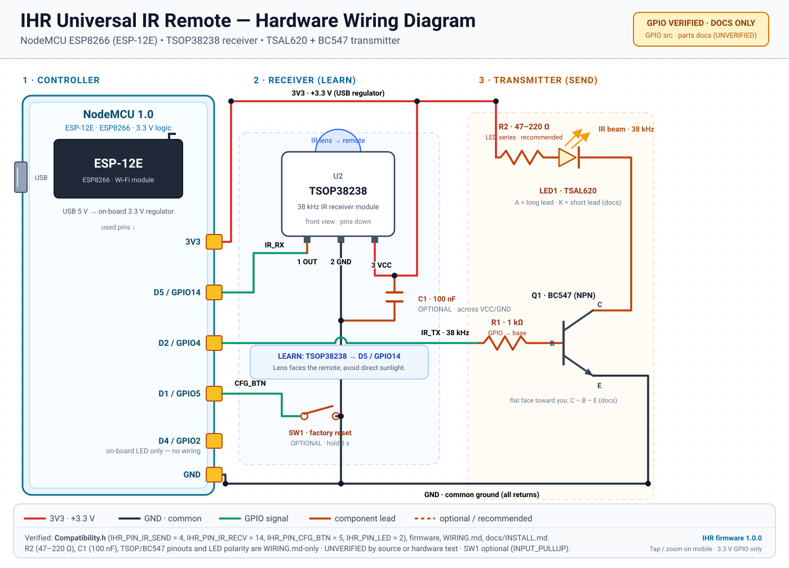

# ওয়্যারিং গাইড (খালি চোখে বুঝুন)

এই গাইডে NodeMCU ESP-12E-র সঙ্গে TSOP38238 রিসিভার ও TSAL620 আইআর LED কীভাবে লাগাবেন তা দেখানো হয়েছে। কোনো সোল্ডারিংয়ের অভিজ্ঞতা না থাকলেও সহজে কাজ করা যায়—শুধু ধীরে ধীরে করুন।

> ⚠️ **বহু বৈদ্যুতিক কাজের আগে USB কেবল খুলে রাখুন।** সংযোগ শেষ হলে আবার লাগান।

---

## হার্ডওয়্যার ওয়্যারিং ডায়াগ্রাম (2D)

নিচের ডায়াগ্রামটি `Compatibility.h`-এর `IHR_PIN_*` সংজ্ঞা, ফার্মওয়্যার ও এই গাইডের সংযোগ-বিবরণ থেকে তৈরি। **কোনো GPIO পিন বদলানো হয়নি**—চিত্রে যেভাবে দেখানো হয়েছে, source-এও ঠিক সেভাবেই আছে।



| ফরম্যাট | ফাইল | ব্যবহার |
|---|---|---|
| Scalable SVG | [ihr-ir-wiring.svg](docs/images/ihr-ir-wiring.svg) | GitHub-এ ইনলাইন দেখা যায়; জুম করলেও অস্পষ্ট হয় না (মোবাইলে ছবিতে ট্যাপ করে জুম করুন) |
| PNG প্রিভিউ (2800 × 2020) | [ihr-ir-wiring.png](docs/images/ihr-ir-wiring.png) | যেসব জায়গায় SVG দেখা যায় না |

**যাচাইয়ের সীমা (source বনাম ডকুমেন্ট):**

| চিত্রের অংশ | সংযোগ | যাচাই |
|---|---|---|
| D2 / GPIO4 | 1kΩ → BC547 **base** | GPIO নম্বর `IHR_PIN_IR_SEND 4` + firmware-এ যাচাই; 1kΩ/base সংযোগ শুধু [অংশ ৩](#৩-আইআর-led-অংশ-ট্রান্সমিটার) — **UNVERIFIED** |
| BC547 **C** | TSAL620 cathode (ছোট পা) | শুধু [অংশ ৩](#৩-আইআর-led-অংশ-ট্রান্সমিটার) — **UNVERIFIED** |
| TSAL620 **A** (লম্বা পা) | 47–220Ω → 3V3 | শুধু [অংশ ৩](#৩-আইআর-led-অংশ-ট্রান্সমিটার) — **UNVERIFIED**; মান পরামর্শ, firmware-এ fixed নয় |
| BC547 **E** | GND | শুধু [অংশ ৩](#৩-আইআর-led-অংশ-ট্রান্সমিটার) — **UNVERIFIED** |
| D5 / GPIO14 | TSOP38238 **pin 1 (OUT)** | GPIO নম্বর `IHR_PIN_IR_RECV 14` + firmware-এ যাচাই; pin ক্রম শুধু [অংশ ৪](#৪-আইআর-রিসিভার-অংশ-tsop38238) — **UNVERIFIED** |
| TSOP pin 2 / pin 3 | GND / 3V3 | শুধু [অংশ ৪](#৪-আইআর-রিসিভার-অংশ-tsop38238) — **UNVERIFIED** |
| D1 / GPIO5 | ঐচ্ছিক SW1 → GND (`INPUT_PULLUP`, ৩ সেকেন্ড) | GPIO, pullup ও ৩ সেকেন্ড logic source-এ যাচাই; বাইরের wiring **UNVERIFIED** |
| D4 / GPIO2 | শুধু বিল্ট-ইন LED (active LOW) | `IHR_PIN_LED 2` + `ihrSetLed()` source-এ যাচাই; বাইরে লাগাবেন না |

`R1` (1kΩ), `R2` (47–220Ω), `C1` (100nF), TSOP38238/BC547-এর পিন ক্রম ও TSAL620 polarity শুধু এই গাইডে আছে—রিপোজিটরিতে schematic, BOM, datasheet বা হার্ডওয়্যার টেস্ট নেই, তাই **UNVERIFIED**। 38 kHz ডিফল্ট ক্যারিয়ার firmware-এ যাচাই করা (`khz = 38`); TSOP38238-র ভেতরের ফিল্টার দাবিও **UNVERIFIED**।

---

## ১. প্রয়োজনীয় অংশ

| অংশ | কতটি | মন্তব্য |
|---|---|---|
| NodeMCU ESP8266 ESP-12E | ১ | USB-তে পাওয়ার পাবে |
| TSOP38238 (আইআর রিসিভার) | ১ | টিভির রিমোটের সংকেত ধরে |
| TSAL620 (আইআর LED) | ১ | সংকেত পাঠায় (অদৃশ্য আলো) |
| BC547 (NPN ট্রানজিস্টর) | ১ | LED-কে ড্রাইভ করে |
| 1kΩ রেজিস্টার | ১ | GPIO → BC547 **base**-এ |
| 47–220Ω রেজিস্টার | ১ *(পরামর্শ)* | LED-র সঙ্গে সিরিজে; নিরাপদ রেঞ্জের জন্য |
| 100nF (0.1µF) ক্যাপাসিটর | ১ *(পরামর্শ)* | TSOP-এর VCC–GND-র পাশে |
| Push button | ১ *(ঐচ্ছিক)* | D1 → GND, ৩ সেকেন্ড ধরে ফ্যাক্টরি রিসেট |

আপনার কাছে শুধু 1kΩ থাকলে কাজ চলবে, কিন্তু LED-র সঙ্গে 47–220Ω যোগ করলে কম তাপ ও বেশি দূরত্ব পাবেন।

---

## ২. NodeMCU-র পিন চিনুন

NodeMCU বোর্ডের দুই পাশে লেখা থাকে **D0…D8**। আমাদের কাজে:

| NodeMCU পিন | GPIO | কাজ |
|---|---|---|
| **D2** | GPIO4 | আইআর LED পাঠানো (1kΩ → BC547 base) |
| **D5** | GPIO14 | TSOP38238-এর OUT |
| **D1** | GPIO5 | ঐচ্ছিক reset button → GND |
| **D4** | GPIO2 | বিল্ট-ইন LED (কোডেই আছে, লাগাবেন না) |
| **3V3** | — | TSOP VCC + LED অ্যানোড (রেজিস্টারের মাধ্যমে) |
| **GND** | — | সবকিছুর মিলিত মাটি |

Boot-এ সমস্যা এড়াতে **D3/GPIO0, D4-এর বাইরের ব্যবহার, D8/GPIO15 কোথাও লাগাবেন না** (D4 শুধু বিল্ট-ইন LED)।

---

## ৩. আইআর LED অংশ (ট্রান্সমিটার)

```
   3V3  ──[ 47–220Ω ]──>|-----┐
                      TSAL620 │   ( anode = লম্বা পা, cathode = ছোট পা )
                              │
                              C   BC547  (সামনের সমতল তল আপনার দিকে,
   D2/GPIO4 ──[ 1kΩ ]──────── B         পা নিচে রাখলে: C - B - E বাঁ থেকে ডানে)
                              E
                              │
   GND  ──────────────────────┘
```

**ধাপ:**
1. TSAL620-এর **লম্বা পা (anode, +)** → 47–220Ω রেজিস্টার → **3V3**।
2. **ছোট পা (cathode, −)** → BC547-এর **Collector (C)**।
3. BC547-এর **Emitter (E)** → **GND**।
4. BC547-এর **Base (B)** → **1kΩ** রেজিস্টার → NodeMCU **D2**।

> BC547-এর পা চিনুন: সমতল (flat) তলটি আপনার দিকে করে পা নিচে রাখলে বাঁ থেকে ডানে **C – B – E**।

---

## ৪. আইআর রিসিভার অংশ (TSOP38238)

TSOP38238-এর **গোল অংশ (লেন্স)** আপনার দিকে করে পা নিচে রাখলে বাঁ থেকে ডানে:

```
        ╭───────╮
        │  ●    │  ← লেন্স (রিমোটের দিকে তাক করুন)
        ╰───┬───┘
            ├── 1  OUT  ─────────── D5 / GPIO14
            ├── 2  GND  ─────────── GND
            ╰── 3  VCC  ─────────── 3V3
                         │
                    100nF (ঐচ্ছিক)
                    VCC ─||─ GND  (পিনের যত কাছে সম্ভব)
```

**ধাপ:**
1. পা **1 (OUT)** → **D5/GPIO14**।
2. পা **2 (GND)** → **GND**।
3. পা **3 (VCC)** → **3V3**।
4. 100nF ক্যাপাসিটর থাকলে VCC ও GND-র ঠিক পাশে লাগান (বিদ্যুৎ নয়জ কমাবে)।

> TSOP38238-এর ভেতরে 38kHz ফিল্টার আছে—তাই আমাদের কোড 38kHz-এ পাঠায়। রোদ/ফ্লোরোসেন্ট লাইটের সামনে রাখলে কম কাজ করতে পারে।

---

## ৫. ঐচ্ছিক রিসেট বাটন

```
   D1 / GPIO5 ────┐
                  │  (push button)
   GND ───────────┘
```

কোডে পিনটি `INPUT_PULLUP` করা আছে—বাটন না লাগালেও কিছু যায় আসে না। বাটন লাগালে **৩ সেকেন্ড** চেপে ধরে ছাড়লে ফ্যাক্টরি রিসেট হবে (বিল্ট-ইন LED জ্বলজ্বল করবে)।

---

## ৬. সব মিলিয়ে (চেকলিস্ট)

| # | পরীক্ষা | ✅ |
|---|---|---|
| 1 | TSAL620-এর লম্বা পা → রেজিস্টার → 3V3 | ☐ |
| 2 | TSAL620-এর ছোট পা → BC547 Collector | ☐ |
| 3 | BC547 Base → 1kΩ → D2 | ☐ |
| 4 | BC547 Emitter → GND | ☐ |
| 5 | TSOP pin1 → D5 | ☐ |
| 6 | TSOP pin2 → GND | ☐ |
| 7 | TSOP pin3 → 3V3 | ☐ |
| 8 | সব GND একই জায়গায় মিলেছে | ☐ |
| 9 | USB লাগানোর আগে শর্ট নেই (LED/রেজিস্টার পরস্পর ঠুচ্ছে না) | ☐ |

---

## ৭. হার্ডওয়্যার পরীক্ষা (২ মিনিট)

1. USB কেবল লাগান। বোর্ডের পাওয়ার LED জ্বলবে।
2. Serial Monitor-এ `1.0.0 ready` দেখুন।
3. ফোনে `IHR-IR-Setup` খুঁজে `http://192.168.4.1` খুলুন।
4. **Learn** ট্যাব → Start learning → আপনার রিমোট দিয়ে একটি বাটন চাপুন। কিছু এলে রিসিভার ঠিক আছে।
5. শেখা বাটনটি সংরক্ষণ করে চাপুন; টিভি সাড়া দিলে ট্রান্সমিটার ঠিক আছে।
6. সাড়া না পেলে **ফোনের ক্যামেরা** খুলে TSAL620-এর দিকে তাক করুন এবং বাটন চাপুন—হালকা বেগুনি আলো দেখা গেলে LED চলছে (চোখে দেখা যায় না, ক্যামেরা দেখতে পায়)।

---

## ৮. সাধারণ ভুল

| ভুল | লক্ষণ | ঠিক |
|---|---|---|
| LED উল্টো লাগানো | ক্যামেরাতেও আলো নেই | লম্বা পা → +3V3 |
| BC547-এর C/E বদল | খুব কম রেঞ্জ বা নেই | flat তল আপনার দিকে: C-B-E |
| TSOP-এর OUT/Pwr বদল | Learn-এ কিছু আসে না | 1=OUT, 2=GND, 3=VCC |
| 1kΩ আর LED-র রেজিস্টার এক জায়গায় | LED জ্বলজ্বলও করে না | 1kΩ = base, 47–220Ω = LED সিরিজে |
| GND মিলেনি | কিছুই কাজ করে না | সব GND একসঙ্গে জুড়ুন |
| রোদ/UV ল্যাম্পের সামনে | শিখতে অনিয়মিত | রিসিভারকে ছায়ায় রাখুন |

আরও সাহায্য: [README.md](README.md)-এর “সমস্যা হলে” অংশ দেখুন।
